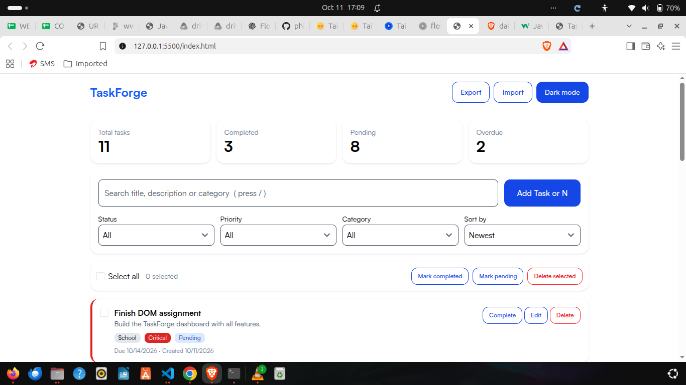
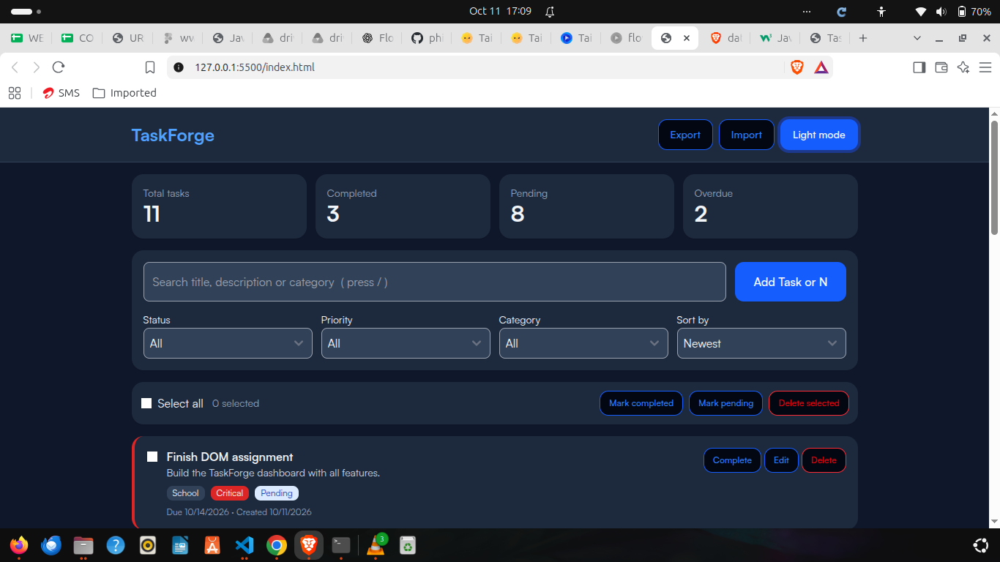
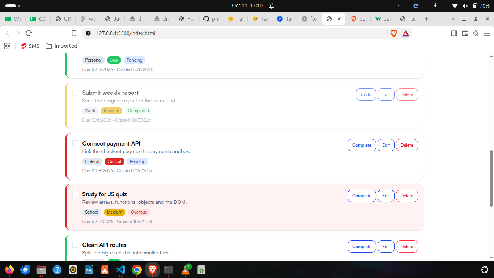
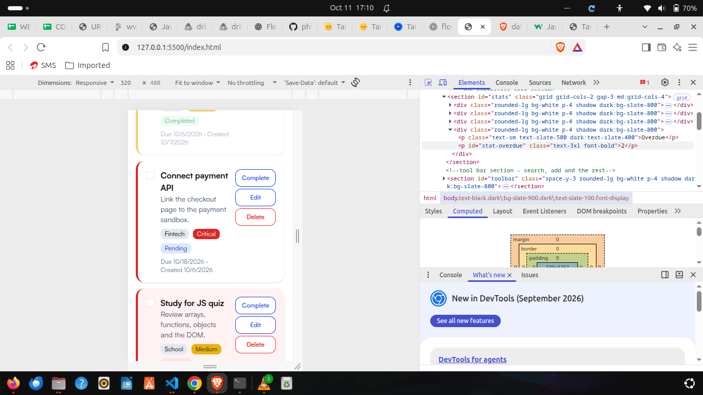

# TaskForge

A task management dashboard built with plain HTML, CSS (Tailwind) and JavaScript, for a DOM manipulation assignment. Tasks can be created, edited, completed, deleted, searched, filtered, sorted and selected in bulk. Everything is saved in the browser with `localStorage`.

## Files

| File | Job |
|---|---|
| `index.html` | The page structure, the modals and a `<template>` for one task card |
| `style.css` | The state classes JavaScript toggles (completed, pending, overdue, four priorities) |
| `app.js` | All the data and behaviour |
| `README.md` | This file |

Tailwind CSS is used for layout and spacing. `style.css` is linked after the Tailwind file so its state classes can override Tailwind where needed.

## Features

- Add, edit, complete/undo and delete tasks
- Form validation with messages shown under each field (title 3+ characters, description 10+, category, priority and due date required)
- Delete confirmation modal, and a task details modal with close, edit and delete
- Search by title, description or category
- Filters for status, priority and category that work together with the search
- Eight sort options (newest, oldest, A to Z, Z to A, priority high/low, due date closest/furthest)
- Stats: total, completed, pending and overdue (they update on every render)
- Checkboxes, Select all, a selected counter, and bulk delete / complete / pending
- Overdue detection: a task is overdue when its due date has passed and it is not completed
- Empty state and "No tasks found" message
- Unsaved-changes warning when cancelling an edit
- Dark mode, saved between visits
- 11 sample tasks on first launch
- Keyboard shortcuts: **N** new task, **/** focus search, **ESC** close the top modal, **Ctrl + Enter** submit the form

## How the app works

### Task management logic

The app follows one rule: **change the data, save it, then redraw from the data.** The page is never edited piece by piece.

1. All tasks live in one array called `tasks`.
2. Each task is an object: `id`, `title`, `description`, `category`, `priority`, `dueDate` (a `"YYYY-MM-DD"` string), `createdAt` (a timestamp number) and `completed` (true or false).
3. Any change (add, edit, complete, delete, bulk action) updates the array, calls `saveTasks()`, then calls `renderTasks()`.
4. `renderTasks()` does the following:
   - `getVisibleTasks()` filters the array by search text, status, priority and category (a task must pass all four checks), then sorts the result.
   - The list is emptied and a card is built for each visible task by `createTaskCard()`.
   - The empty state or "No tasks found" message is shown or hidden.
   - `updateStats()` and `updateSelection()` refresh the numbers.
5. Add and edit share one form. A variable, `editingId`, is `null` when adding and holds a task id when editing. On submit, the code checks it to decide whether to create a new task or update the existing one.
6. `isOverdue(task)` returns true when the task is not completed and its due date is before today. Dates are compared as strings, which works because the `YYYY-MM-DD` format sorts in date order.
7. Selected tasks are tracked in an array, `selectedIds`. A task that is no longer visible (because of a filter) is removed from the selection on each render, so bulk actions only affect tasks the user can see.

### Event delegation

Cards are destroyed and rebuilt on every render, so putting a listener on every button would mean re-attaching them all the time. Instead there is **one `click` listener on the task list** (`taskList`), which never gets replaced:

1. When anything inside the list is clicked, `event.target.closest("[data-action]")` finds the nearest element that has a `data-action` attribute. If there is none, the handler stops.
2. `getTaskFromElement()` uses `closest(".task-card")` to walk up the DOM to the card, reads `card.dataset.id`, and finds the matching task in the `tasks` array.
3. `button.dataset.action` says what to do: `complete`, `edit`, `delete` or `details`.

Checkboxes fire `change`, not `click`, so they have their own delegated `change` listener on the same list, using the same `closest()` and `dataset.id` steps.

### `data-*` attributes

- `data-id` on every card holds the task's id (set after cloning the template, because it is different for each card).
- `data-action` on the buttons and the card body says what the control does (set once in the HTML template, because it is the same on every card).
- `dataset` is used to read them. Values read from `dataset` are always strings, which is why task ids are strings.

### localStorage

| Key | What it holds |
|---|---|
| `taskforge-tasks` | The whole `tasks` array, saved with `JSON.stringify` |
| `taskforge-theme` | `"dark"` or `"light"` |

- `saveTasks()` writes the array after every change.
- On startup, `JSON.parse(localStorage.getItem("taskforge-tasks"))` loads it. If the result is `null`, this is the first visit, so 11 sample tasks (different categories, priorities, due dates and completion statuses) are created and saved. An empty saved list is not `null`, so deleting every task does not bring the samples back.
- The saved theme is applied before the first render.

## DOM methods used

| Area | Methods and properties |
|---|---|
| Finding elements | `getElementById()`, `querySelector()`, `querySelectorAll()`, `closest()` |
| Building the page | `cloneNode(true)` on the template's card, `firstElementChild` (to get the card inside `template.content`), `append()`, `replaceChildren()` |
| Text | `textContent` |
| Classes | `classList.add()`, `classList.remove()`, `classList.toggle()` (including the two-argument form), `classList.contains()` |
| Data attributes | `dataset` |
| Events | `addEventListener()`, `preventDefault()`, `event.target`, `event.key`, `event.ctrlKey` |
| Storage | `localStorage.getItem()`, `localStorage.setItem()`, `JSON.stringify()`, `JSON.parse()` |

Where they are used:

- **`cloneNode(true)`** copies the hidden `<template>` card for every task, including everything inside it.
- **`querySelector()`** is called on each cloned card to find the title, description, status and so on, so each card is filled in separately.
- **`classList.toggle(name, condition)`** shows or hides the empty-state and "No tasks found" boxes.
- **`querySelectorAll()`** gets every task checkbox on screen to update Select all and to tick or untick them together.
- **`closest()`** powers the event delegation described above.
- **`replaceChildren()`** empties the list before each redraw.

## Not implemented

- Drag-and-drop reordering
- Pagination
- Debounced search
- Undo delete
- Import / export

## Screenshots

